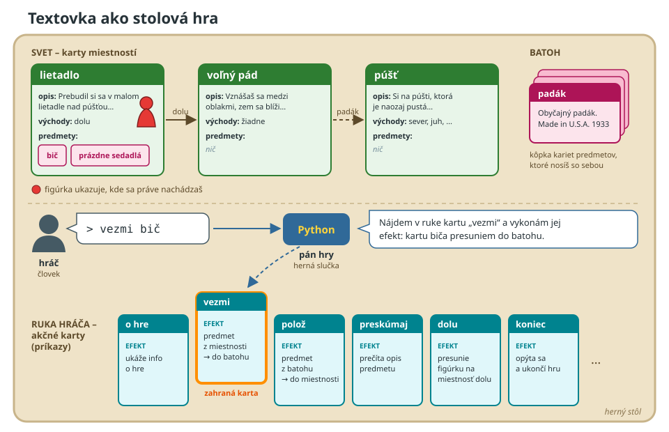
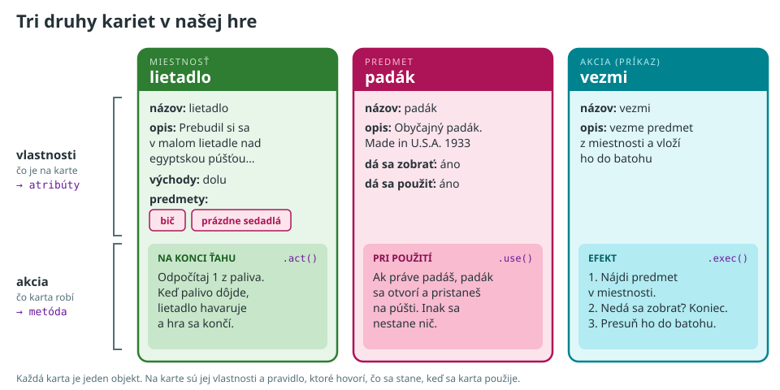
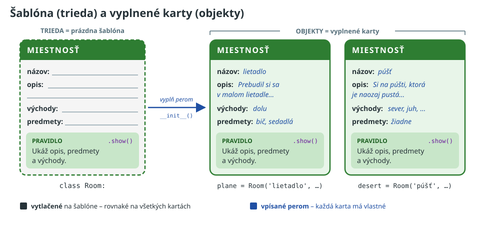
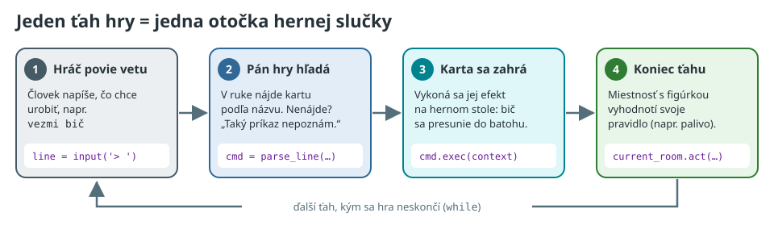

# Úvod do objektovo orientovaného programovania

Textovka ako stolová hra s kartami.


## Goals

1. Identifikovať hlavné stavebné bloky hry a ich vlastnosti
2. Porozumieť tomu, čo znamená _akcia_ (správanie) objektu
3. Porozumieť rozdielu medzi triedou a objektom
4. Osvojiť si pojmy atribút, metóda a `self`
5. Prepojiť ťah hry s hernou slučkou


## Content

### Z čoho sa skladá naša hra?

Skôr, ako začneme písať kód, sa zamyslíme nad tým, z čoho sa naša hra skladá. Keď sa pozrieme na mapu sveta v súbore
[readme.md](../../readme.md) a zahráme si pôvodnú hru, nájdeme tieto hlavné stavebné bloky:

* **miestnosti** - lietadlo, púšť, oáza, tábor, ...
* **predmety** - bič, padák, kľúč, lopata, ...
* **príkazy** - `o hre`, `vezmi`, `poloz`, `sever`, `koniec`, ...

Každý z týchto blokov má nejaké **vlastnosti**:

| blok      | vlastnosti                                           |
|-----------|------------------------------------------------------|
| miestnosť | názov, opis, východy, zoznam predmetov               |
| predmet   | názov, opis, či sa dá zobrať, či sa dá použiť        |
| príkaz    | názov, opis                                          |

Okrem vlastností však každý blok aj **niečo robí**: príkaz `vezmi` presunie predmet do batohu, padák ťa po použití
bezpečne dostane na zem a lietadlo po niekoľkých ťahoch havaruje. Táto _akcia_ sa však opisuje oveľa ťažšie ako
vlastnosti. Pomôžeme si preto prirovnaním, ktoré pozná každý: **stolovou hrou s kartami**.


### Textovka ako stolová hra

Predstavte si, že našu textovku hráme ako stolovú hru:



* **Svet** tvoria _karty miestností_, ktoré ležia na stole.
* **Predmety** sú _karty predmetov_. Ležia na kartách miestností, v ktorých sa nachádzajú.
* **Figúrka** stojí na karte miestnosti, v ktorej sa hráč práve nachádza.
* **Batoh** je kôpka kariet predmetov, ktoré má hráč pri sebe.
* **Príkazy** sú _akčné karty_, ktoré má hráč v ruke. Akčné karty sa nespotrebúvajú, po zahraní sa vrátia späť do ruky.

Pri stole sedia dve postavy:

* **hráč** - človek pri klávesnici. Kartami nikdy nehýbe, iba hovorí, čo chce urobiť (napr. `vezmi bic`).
* **pán hry** - náš program v jazyku Python. Počúva hráča, hľadá v ruke správnu akčnú kartu, vykonáva jej efekt, presúva
  figúrku a predčítava opisy miestností. (Ak ste niekedy hrali _Dračí doupě_, je to presne _Pán jeskyně_.)

Pán hry má jedno prísne pravidlo: **smie urobiť len to, čo je napísané na kartách.** Nič si nedomýšľa a nič neopravuje.
Presne tak sa správa aj počítač.


### Karta = objekt

Pozrime sa na karty bližšie:



Každá karta má dve časti:

1. **Vlastnosti** - políčka s údajmi (názov, opis, východy, ...). V jazyku Python sa im hovorí **atribúty**.
2. **Akcia** - pravidlo, ktoré hovorí, čo sa stane, keď sa karta použije. V jazyku Python sa mu hovorí **metóda**.

Kartu, ktorá má vlastnosti aj pravidlá, nazývame v programovaní **objekt**.

Všimnite si, že každý druh karty má pravidlo, ktoré sa spúšťa v inom momente:

| karta      | kedy sa pravidlo spustí                                 | metóda     |
|------------|---------------------------------------------------------|------------|
| akčná karta | keď ju hráč zahrá                                      | `.exec()`  |
| predmet    | keď ho hráč použije (príkazom `pouzi`)                  | `.use()`   |
| miestnosť  | na konci každého ťahu, ak na nej stojí figúrka          | `.act()`   |

A práve toto je odpoveď na otázku, čo je to _akcia_: **pravidlo napísané na karte**.


### Šablóna = trieda

Karty sa netvoria od nuly. V tlačiarni majú pre každý druh karty **šablónu** - prázdnu kartu s vytlačenými políčkami
a vytlačeným pravidlom. Konkrétnu kartu potom vytvoríme tak, že políčka v šablóne vyplníme perom.



* **Trieda** je šablóna. Hovorí, aké políčka a pravidlá bude mať každá karta daného druhu.
* **Objekt** (inštancia) je konkrétna vyplnená karta. Z jednej šablóny ich môžeme vytvoriť ľubovoľne veľa.
* To, čo je **vytlačené** na šablóne, je rovnaké na všetkých kartách (napr. pravidlo `.show()`).
* To, čo je **vpísané perom**, má každá karta vlastné (napr. názov a opis miestnosti). Ak prepíšem opis na karte
  lietadla, karta púšte sa nezmení.

Niektoré karty sú však **unikátne** - v hre existujú iba raz a nič sa na nich nevypĺňa. Typickým príkladom sú akčné
karty: karta `o hre` je v ruke iba jedna a všetko na nej je vytlačené už v tlačiarni. Práve takéto karty budeme
vytvárať ako prvé.


### Jeden ťah hry

Keď to celé spojíme dokopy, jeden ťah hry vyzerá takto:



1. Hráč povie vetu.
2. Pán hry nájde v ruke akčnú kartu, ktorej názov zodpovedá vete. Ak ju nenájde, odpovie `Taký príkaz nepoznám.`
3. Karta sa zahrá - vykoná sa jej efekt na hernom stole.
4. Na konci ťahu miestnosť, na ktorej stojí figúrka, vyhodnotí svoje pravidlo.

A potom znova od začiatku, až kým sa hra neskončí. Toto je presne naša herná slučka `while`. Kód pod jednotlivými
krokmi je cieľ, ku ktorému sa počas kurzu postupne dopracujeme.


### Ukážka: hra v chate

Pred písaním kódu si to vyskúšame naživo. Lektor zdieľa obrazovku s kartami a hrá úlohu **pána hry (Pythona)**.
Účastníci sú **hráči** a do chatu píšu vety, čo chcú urobiť. Lektor sa pri tom striktne drží iba toho, čo je napísané
na kartách.

Na čo sa pri hre zamerať:

* Hráč napíše `zober bic`. Karta sa však volá `vezmi`, takže pán hry musí odpovedať `Taký príkaz nepoznám.` Človek by
  to pochopil, počítač nie.
* Hráč napíše `vezmi lopata`, ale lopata v miestnosti nie je. Čo je napísané na karte `vezmi`? Pán hry nesmie nič
  domýšľať, takže pravidlo na karte musí tento prípad riešiť.
* Hráč napíše `vezmi prazdne sedadla`. Na karte predmetu je napísané, že sa nedá zobrať. Kto to má skontrolovať?
  Karta predmetu, alebo akčná karta `vezmi`?

Z každej takejto situácie vznikne jedna podmienka `if` v metóde `.exec()`.


### Z karty do kódu

Začneme akčnými kartami. Všetky akčné karty majú spoločný **rámček**: políčko pre názov, políčko pre opis a políčko
pre efekt. Tento rámček je trieda `BaseCommand`:

```python
class BaseCommand:
    name: str
    description: str

    def exec(self):
        pass
```

* `name` a `description` sú **atribúty** - políčka na karte. Zápis `name: str` zatiaľ hovorí iba to, že také políčko
  bude existovať a bude v ňom reťazec.
* `exec()` je **metóda** - políčko EFEKT. V rámčeku je zatiaľ prázdne (`pass`). Každá konkrétna karta si ho vyplní
  vlastným pravidlom.

Konkrétna karta `o hre` vznikne z tohto rámčeka. V zátvorke za názvom triedy uvedieme, z ktorého rámčeka karta vychádza:

```python
class About(BaseCommand):
    name = 'o hre'
    description = 'Zobrazí informácie o hre.'

    def exec(self):
        print('(c)2026 created by mirek')
        print('Ďalšie dobrodružstvo Indiana Jonesa tentokrát vytvorené v jazyku Python.')
```

Karta `o hre` je unikátna, preto sú všetky jej údaje vytlačené priamo v triede.

Trieda je však stále iba šablóna. Aby sme mohli kartu zahrať, musíme ju najprv vytvoriť - vytvoriť **objekt**:

```python
about = About()     # vytvorím kartu podľa šablóny About
print(about.name)   # prečítam políčko na karte
about.exec()        # zahrám kartu
```

**Pozor na zátvorky:** `About` je šablóna, `About()` je karta.


### Čo je to `self`?

Pri zahraní karty Python potrebuje vedieť, **ktorú kartu** práve hráme. Tieto dva riadky robia presne to isté:

```python
about.exec()
About.exec(about)   # použi pravidlo zo šablóny About na kartu about
```

Python si kartu, nad ktorou metódu voláme, doplní do parametra `self` sám. **`self` je karta, ktorú práve držím v
ruke.** Preto má každá metóda ako prvý parameter `self` a cez neho sa dostane k políčkam svojej karty:

```python
def exec(self):
    print(f'Hráš kartu {self.name}.')
```


### Náhľad: karty vypĺňané perom

Miestnosti a predmety nie sú unikátne - kariet miestností bude v hre veľa a každá bude vyplnená inak. Pre takéto karty
pridáme do šablóny špeciálnu metódu `__init__()`, ktorá sa zavolá pri vytvorení novej karty a **vpíše** do nej údaje
perom:

```python
class Room:
    def __init__(self, name, description):
        self.name = name                # vpíš názov na TÚTO kartu
        self.description = description  # vpíš opis na TÚTO kartu

    def show(self):
        print(self.description)


plane = Room('lietadlo', 'Prebudil si sa v malom lietadle...')
desert = Room('púšť', 'Si na púšti, ktorá je naozaj pustá.')

plane.show()
desert.show()
```

K miestnostiam sa podrobne dostaneme na tretí deň.


## Slovníček pojmov

| stolová hra                              | Python                 | v textovke                         |
|------------------------------------------|------------------------|------------------------------------|
| šablóna karty                            | trieda                 | `BaseCommand`, `Room`, `Item`      |
| vyplnená karta                           | objekt (inštancia)     | `About()`, lietadlo, padák         |
| políčko na karte                         | atribút                | `name`, `description`              |
| pravidlo na karte                        | metóda                 | `.exec()`, `.use()`, `.act()`      |
| vypĺňanie novej karty perom              | `__init__()`           | `Room('púšť', '...')`              |
| karta, ktorú práve držím v ruke          | `self`                 | `self.name`                        |
| karta vytvorená z iného rámčeka          | dedenie                | `class About(BaseCommand)`         |
| pán hry                                  | herná slučka           | `while` v `main.py`                |


## Časté chyby

* `about = About` miesto `about = About()` - v stolovej hre by to bolo, ako keby ste chceli hrať so šablónou miesto
  karty.
* Chýbajúci parameter `self` v definícii metódy - Python skončí s chybou
  `TypeError: About.exec() takes 0 positional arguments but 1 was given`. Python totiž kartu do metódy posiela vždy.
* `name = name` miesto `self.name = name` v metóde `__init__()` - hodnota sa nevpísala na kartu, ale "do vzduchu".
* `Room` vs. `room` - trieda (šablóna) sa podľa konvencie píše s veľkým písmenom (`CamelCase`), objekty (karty) malými
  písmenami.


## Additional Tasks

1. **Lab:** Navrhnite (zatiaľ len slovami, bez kódu) akčné karty `prikazy` a `koniec`. Pre každú kartu napíšte jej
   názov, opis a efekt tak presne, aby ho pán hry vedel vykonať bez domýšľania.

2. Zamyslite sa: šesť akčných kariet na pohyb (`sever`, `juh`, `vychod`, `zapad`, `hore`, `dolu`) má úplne rovnaký
   efekt, líšia sa len smerom. Ako by ste to riešili, keby ste tieto karty tlačili v tlačiarni?
